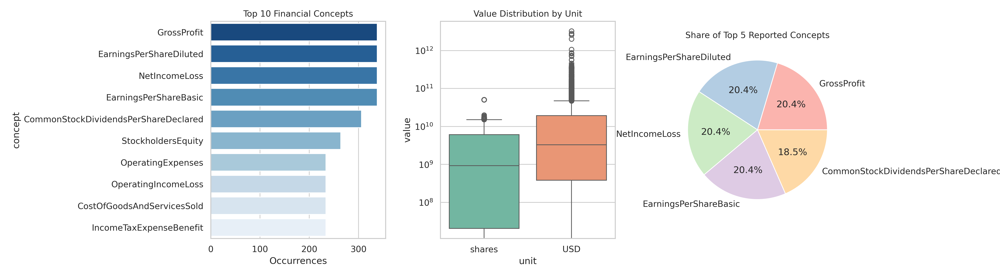

# final-project

## dataset
- [Apple_Stocks_Dataset](https://www.kaggle.com/datasets/blixture/apple-stocks)

# Financial Data Analytics with Python

## project overview
This project analyzes financial facts contained in financial_facts.csv. My goal was to explore, clean, manipulate, and visualize SEC financial metrics using Python.

Questions:
- What are the most commonly reported financial concepts in SEC filings?
- How do the numerical values differ across different measurement units (USD or shares)?
- How many of the reports do the top financial metrics represent?

df = pd.read_csv('/content/financial_facts.csv')

### Data Cleaning
- Missing Values: Checked missing values in columns using df.isnull().sum().
- Duplicates: Removed duplicates from the dataset using df.drop_duplicates().

### Data Manipulation
1. Filtering: Filtered data to focus on USD and shares units (df['unit'].isin(['USD', 'shares'])).
2. Grouping: Grouped the data by concept to find the count, mean, and median values.
3. Sorting: Sorted concepts by occurrence in descending order (sort_values(by='count', ascending=False)) to find the top 5 financial metrics.

### Statistical Analysis
- Descriptive Statistics: Calculated descriptive summary (count, mean, std, median, min, max, quartiles) grouped by units.
- Correlation: Calculated number correlation to see relationships between financial values and reporting years.

##  Visualizations

1. Top 10 Financial Concepts (Bar Chart): shows that the metrics, including: Net Income/Loss, Gross Profit, and Stockholders Equity are among the most frequently reported financial concepts.
2. Value Distribution (Box Plot): shows the distribution of reported numbers, highlighted large differences and unique outliers between share counts and amounts.
3. Top 5 Concepts (Pie Chart):  shows the relative amount of occurrences between the top 5 reported financial metrics.
